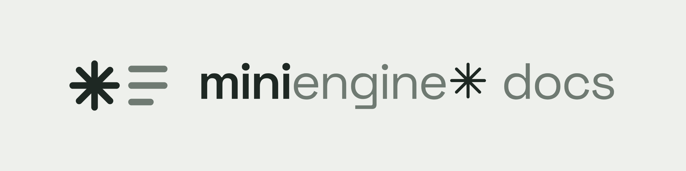

<picture>
  <source media="(prefers-color-scheme: dark)" srcset=".github/assets/banner-donker.png">
  
</picture>

# Mini Engine Docs

De documentatiesite van Mini Engine en de Mini Engine SDK. Statische HTML, geen JavaScript-frameworks, gehost op GitHub Pages onder `https://docs.miniengine.nl/`.

De engine-repository is privé; deze repository, de SDK en de CLI zijn publiek. Zet hier dus geen sleutels, interne URL's of code uit die repositories die niet openbaar mag.

## Bouwen

Vereist Node.js 20 of nieuwer.

```sh
npm ci
node build.mjs
```

`build.mjs` zet `content/**/*.md` om naar `site/`, met `template.html` als enige sjabloon, en kopieert `static/` (stijl, lettertypes, logo's, favicon, downloads) mee. De enige afhankelijkheid is [marked](https://marked.js.org/), vastgezet op `18.0.14`.

## Lokaal bekijken

```sh
npm run serve          # of: node scripts/serve.mjs 4173
```

Open `http://localhost:4173/`. De server bedient de site ook op `http://localhost:4173/mini-engine-docs/`, het pad van GitHub Pages, zodat ook `404.html` klopt. `npx serve site` werkt ook, behalve voor de 404-pagina.

## Links controleren

```sh
node scripts/check-links.mjs                       # faalt ook als de pdf ontbreekt
node scripts/check-links.mjs --allow-missing-pdf   # pdf ontbreekt alleen als waarschuwing
npm run check                                      # bouwen + linkcontrole
```

De controle volgt elke interne `href`, `src` en `srcset`, inclusief ankers. Externe links slaat hij over.

## Schrijven

Elke pagina is een Markdown-bestand met front matter:

```markdown
---
title: Kamers en rollen
nav_title: Kamers en rollen      # optioneel, korter label in het menu
description: Eén zin voor zoekmachines en de meta-beschrijving.
section: Concepten
order: 1
toc_depth: 3                     # optioneel: ook ###-koppen in "Op deze pagina"
toc: false                       # optioneel: geen inhoudsopgave
---
```

- `section` moet in de lijst `SECTIONS` bovenaan `build.mjs` staan; die lijst bepaalt de volgorde in het menu. Binnen een sectie sorteert `order`.
- Link naar andere pagina's met hun relatieve `.md`-pad, bijvoorbeeld `[runtimes](../concepten/runtimes.md#serverruntime)`. De build maakt er `.html` van en stopt bij een link naar een onbekende pagina.
- Gebruik `{{root}}` voor bestanden uit `static/`, bijvoorbeeld `{{root}}brand/woordmerk-licht.svg`.
- Koppen krijgen automatisch een id en een ankerlink. De inhoudsopgave verschijnt bij drie of meer `##`-koppen.
- Schrijf in het Nederlands, in zinnen, met sentence case. Merkregels: `content/merk.md`.

## URL's en BASE

Alle pagina's linken relatief, dus de site werkt onder elk pad, ook als losse bestanden. Alleen `404.html` gebruikt absolute links, omdat GitHub Pages hem op elk pad toont. Die basis staat op één plek: `BASE` in `build.mjs` (standaard `/mini-engine-docs/`, of zet `DOCS_BASE`). Hernoem je de repository of gebruik je een eigen domein, pas dan alleen `BASE` aan (`DOCS_BASE=/ node build.mjs` voor een domein zonder pad).

## De API-referentie als pdf

De site linkt naar `downloads/MiniEngine-API-v0.5.pdf` (`PDF` in `build.mjs`; `scripts/check-links.mjs` leest dezelfde waarde). Zet het bestand in `static/downloads/MiniEngine-API-v0.5.pdf`; oudere edities blijven ernaast staan. De build kopieert het naar `site/downloads/`. Zolang het ontbreekt, meldt de build een waarschuwing en faalt de strikte linkcontrole. `VERSION` in `build.mjs` is de versie in de voettekst.

## Publiceren op GitHub Pages

1. Maak op GitHub een **publieke** repository `Casb02/mini-engine-docs` (zonder README, om conflicten te voorkomen).
2. Push deze map:

   ```sh
   git add .
   git commit -m "docs: eerste versie van de documentatiesite"
   git remote add origin git@github.com:Casb02/mini-engine-docs.git
   git push -u origin main
   ```

3. Ga in de repository naar **Settings → Pages** en kies bij **Build and deployment → Source** voor **GitHub Actions**.
4. De workflow `.github/workflows/pages.yml` bouwt bij elke push naar `main`, controleert de links en publiceert `site/`. Je kunt hem ook handmatig starten via **Actions → Pages → Run workflow**.
5. De site staat daarna op `https://casb02.github.io/mini-engine-docs/`. Met een eigen domein (hier `docs.miniengine.nl`) zet je dat domein onder **Settings → Pages → Custom domain** en `DOCS_BASE: /` in `.github/workflows/pages.yml`.

`site/` staat in `.gitignore`: GitHub bouwt de site zelf. De build schrijft `site/.nojekyll`, zodat Pages de bestanden ongewijzigd serveert.

## Licenties

De lettertypes Space Grotesk en DM Sans vallen onder de SIL Open Font License 1.1; de licentieteksten staan naast de bestanden in `static/fonts/`. Logo's en kleuren komen uit het merkpakket van Mini Engine (merk v1.0).
